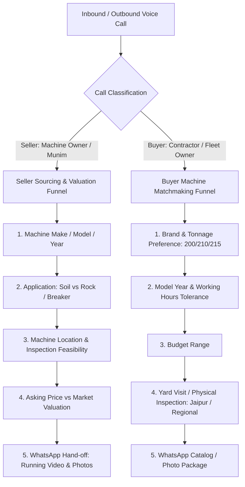

# Vaani — Human Sales Pattern Extraction & Dialogue Knowledge

**Project:** RapidX  
**Agent:** Vaani — AI Used Excavator Sales & Calling Agent  
**Source Base:** 18 Human WhatsApp Audio Recordings (23m 05s total runtime)

---

## 1. Executive Summary of Human Sales Behavior

Analysis of the 18 real human sales recordings reveals two primary commercial funnels:

---

## 2. Seller Sourcing Funnel (Buying from Owners/Brokers)

### A. Stage-by-Stage Human Dialogue Pattern

1. **Establish Identity & Machine Scope:**
   - *"Sir, aapki excavator / Poclain machine sell karni thi?"*
   - *"Yeh machine aapki khud ki hai ya aap kisi aur (party/munim) ke through baat kar rahe hain?"* (Recording #11)
2. **Machine Identification & Specification Extraction:**
   - **Brand & Model:** Tata Hitachi EX 200 / JCB JS 205 / Hyundai R210 / Komatsu.
   - **Manufacturing / Registration Year:** *"Kaunsa model hai sir? 2019 ka hai ya 2024 ka?"* (Recording #7, #13, #14).
3. **Application & Operational History (Crucial Industry Nuance):**
   - **Soil vs Rock distinction:** *"Mitti mein chali hui machine hai ya pahadon mein chali hui hai?"* (Recording #13).
   - *Rationale:* Machines operated in soft earth/soil have significantly less structural wear, lower boom fatigue, and cleaner hydraulic pumps compared to machines operated in mountain stone quarries with heavy rock breakers.
4. **Machine Location:**
   - *"Abhi machine kahan pe khadi hai? Current working site pe hai ya yard mein?"* (Satara, Singrauli, Assam, Jaipur, Kishangarh).
5. **Price Negotiation & Realistic Anchoring:**
   - When seller gives an inflated asking price:
     - *Seller:* *"Minimum price ₹25 Lakh."*
     - *Agent Counter:* *"Sir, 2019 model ke hisaab se ₹25 Lakh to kaafi zyada bol rahe hain... hum aage customer ko resell karte hain, margin nikalna hota hai."* (Recording #13, #14).
6. **Closing & WhatsApp Asset Request:**
   - *"Aap ek kaam kijiye, machine ki chaaron taraf se saaf photos, meter reading ka photo, aur ek 30 second ki running video WhatsApp pe bhej dijiye. Hum technical team se check karwa ke final offer dete hain."* (Recording #7, #12, #14, #17).

---

## 3. Buyer Sales Funnel (Selling to Contractors)

### A. Stage-by-Stage Human Dialogue Pattern

1. **Warm Greeting & Company Introduction:**
   - *"Namaste sir, main Om Shanti Earthmovers / RapidX network se baat kar raha/rahi hoon. Aapko used excavator / Poclain machine chahiye thi?"* (Recording #18).
2. **Requirement Qualification:**
   - *"Aapko kaunsi brand mein dekhna hai sir? Tata 200, JCB 205, ya Hyundai?"*
   - *"Aapko kitne saal purani model chalegi? 2018-2019 ya latest 2022-2024?"*
3. **Location & Physical Yard Inspection Scheduling:**
   - *"Sir hamara yard Jaipur mein Loha Mandi / VKI Area mein hai. Aap kab aana chahenge machine dekhne ke liye?"* (Recording #10, #13).
   - *"Main aapko WhatsApp pe yard ki Google Maps live location aur catalog share kar deti hoon."* (Recording #10).
4. **Buyer Budget & Commercial Fit:**
   - Qualify payment capability (down payment vs full cash vs finance requirement).
5. **WhatsApp Engagement & Conversion:**
   - *"Aapka yeh number WhatsApp pe chal raha hai na? Main abhi Tata EX 200 aur JCB JS 205 ki photos aur video bhej raha hoon."* (Recording #8, #15).

---

## 4. Confidence Matrix & Evidence Grading

| Sales Dimension | Observed Pattern | Confidence Level | Grounding Evidence |
|-----------------|------------------|------------------|--------------------|
| **Soil vs Mountain / Rock History** | Explicit check if machine worked in *mitti* (soil) vs *pahad* (stone quarry/breaker). | **HIGH** | Explicitly stated in Recording #13 (`[064.0s - 072.0s]`). |
| **WhatsApp Asset Exchange** | Mandatory transition from voice call to WhatsApp photos/running video. | **HIGH** | Present in 9 out of 14 voice interactions. |
| **Year-Based Price Anchoring** | 2019 models negotiated around ₹20-25L; 2024 models evaluated near ₹33-35L. | **HIGH** | Stated in Recordings #7, #13, #14. |
| **Jaipur Yard Hub** | Physical inspection hub located at Jaipur (Loha Mandi / VKI Area). | **HIGH** | Explicitly referenced in Recordings #10, #13. |
| **Munim / Broker Qualification** | Checking if caller is direct owner or intermediary (*Munim*). | **HIGH** | Explicitly asked in Recording #11 (`[035.0s]`). |
| **Detailed RTO / Financing Status** | In-depth checking of NOC, hypothecation, and road tax validity. | **MEDIUM (Inferred)** | Implied during document collection, but human callers often deferred this to WhatsApp. |
| **Engine Overhaul / Pump Health** | Technical pump pressure and undercarriage percentage metrics. | **LOW (Call Gap)** | Human callers rarely asked numeric PSI/wear % over the phone; relied entirely on photo/video follow-up. |

---

## 5. Human Mistakes to Avoid in AI Vaani

| Human Caller Mistake | Risk / Flaw | Vaani Engineering Remedy |
|----------------------|-------------|--------------------------|
| **Vague location checks** (e.g. asking "Kishangarh" then guessing "Ajmer ya Alwar?") | Creates confusion and wastes call duration. | Vaani uses a structured Rajasthan & National district entity extractor. |
| **Skipping owner vs broker check early** | Spending 3 minutes negotiating price only to realize the caller has no selling authority. | Vaani asks ownership status within the first 3 turns. |
| **Unanchored pricing** | Asking *"Aap kitna doge?"* without knowing model year or machine condition. | Vaani grounds price expectations on model year, brand, and soil/rock history before quoting. |
| **Over-promising yard availability** | Telling buyer all models are ready in yard without checking inventory. | Vaani offers specific matching inventory or promises targeted WhatsApp catalog within 10 minutes. |
| **Mumbling numbers over phone** | Calling party unable to write down mobile number accurately. | Vaani verifies caller ID automatically and confirms: *"Kya main isi number ke WhatsApp pe details bhej doon?"* |
