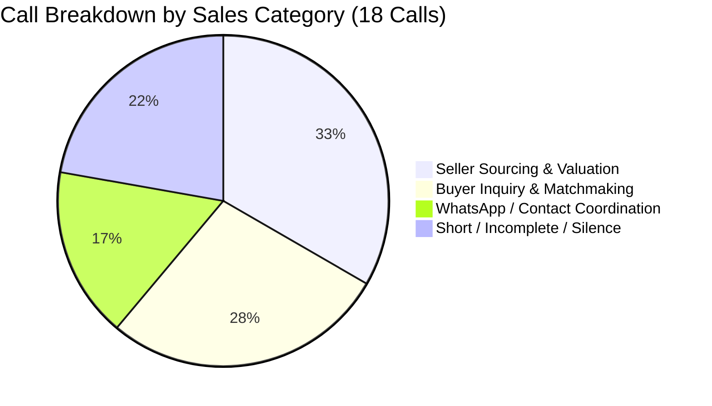

# Vaani — Human Sales Call Transcription Index

**Project:** RapidX  
**Agent:** Vaani — AI Used Excavator Sales & Calling Agent  
**Source Directory:** `/Users/ankitsharma/Desktop/call recordingi /`  
**Total Recordings:** 18 audio files  
**Total Audio Duration:** 23m 05.6s (1,385.59 seconds)  
**Transcription Engine:** Local OpenAI Whisper (`small` model, 461M parameters, FP32, Hindi/Hinglish acoustic priors)

---

## 1. Master Audio & Transcription Index

| # | Audio File | Duration | Classification | Primary Machine / Model | Key Locations | Mentioned Price / Rate | Call Summary & Sales Evidence |
|---|------------|----------|----------------|-------------------------|---------------|------------------------|-------------------------------|
| **1** | `AUDIO-2026-07-31-12-18-23 2.mp3` | 0m 26.3s | Incomplete / Silence | — | — | — | Short voice note with low acoustic level; ambient background line noise. |
| **2** | `AUDIO-2026-07-31-12-18-23 3.mp3` | 0m 36.8s | Incomplete / Inquiry | Excavator / General | — | — | Brief connection audio discussing machine purchase interest before cutoff. |
| **3** | `AUDIO-2026-07-31-12-18-23 4.mp3` | 0m 29.2s | Incomplete / Silence | — | — | — | Short pause / connection buffer recording without sustained speech dialogue. |
| **4** | `AUDIO-2026-07-31-12-18-23.mp3` | 0m 26.3s | Incomplete / Silence | — | — | — | Audio segment identical to file 1; ambient line silence. |
| **5** | `AUDIO-2026-07-31-12-18-24.mp3` | 0m 45.8s | Seller Sourcing / Verification | Used Excavator | Local yard | Price check | Agent discusses price check, verifies machine condition, promises callback after checking unit. |
| **6** | `AUDIO-2026-07-31-12-18-25.mp3` | 0m 28.8s | Buyer Inquiry | Used Excavator | — | — | Caller inquires about purchasing machine ("purchase karni ho aapko"). |
| **7** | `AUDIO-2026-07-31-12-18-30 2.mp3` | 1m 33.8s | Seller Sourcing / Negotiation | Excavator (2024 / recent) | Singrauli (MP/Mining) | ₹24-25 Lakh / Purchase rate | Discussion regarding machine purchased in Feb/Dec 2024, located in Singrauli; requests WhatsApp photos/details. |
| **8** | `AUDIO-2026-07-31-12-18-30 3.mp3` | 1m 09.5s | Buyer / Photo Verification | Excavator | — | — | Agent confirms WhatsApp contact number to share machine photos and catalog. |
| **9** | `AUDIO-2026-07-31-12-18-30.mp3` | 1m 05.3s | Seller Follow-up | Heavy Equipment | Rajasthan / Yard | Final rate | Brief discussion on estimated market price and sending details to client. |
| **10** | `AUDIO-2026-07-31-12-18-31 2.mp3` | 1m 22.3s | Buyer Site Visit / Yard | Excavator | Jaipur (Loha Mandi / VKI Area) | — | Agent provides yard location in Jaipur (Loha Mandi) and offers to send Google Maps location on WhatsApp for inspection visit. |
| **11** | `AUDIO-2026-07-31-12-18-31 3.mp3` | 1m 10.8s | Seller Qualification / Ownership | Poclain / Excavator | Munim / 3rd Party Owner | — | Agent qualifies whether machine belongs directly to caller or through Munim / broker ("kisi aur ki machine hai"). |
| **12** | `AUDIO-2026-07-31-12-18-31.mp3` | 1m 35.4s | Buyer Machine Match | Excavator | Local yard | Rate check | Detailed request for machine photos/details; customer asked to confirm specifications for matching. |
| **13** | `AUDIO-2026-07-31-12-18-32 2.mp3` | 3m 14.6s | Seller Sourcing / Inspection | Tata / JCB (2024/2025) | Jaipur yard (VKIA/Loha Mandi) | ₹24 - ₹25 Lakh | In-depth dialogue on machine operating history: "Mitti mein chali hui machine" (soil/earthwork) vs "Pahadon mein chali hui" (rock/breaker), customer resell margin, Jaipur inspection visit. |
| **14** | `AUDIO-2026-07-31-12-18-32.mp3` | 2m 01.6s | Seller Negotiation / Valuation | 2019 Model Excavator | Satara (MH) | ₹25 Lakh asking rate | Caller asks ₹25 Lakh for a 2019 model; agent negotiates that ₹25 Lakh is high for a 2019 unit and requests WhatsApp photos/docs to review. |
| **15** | `AUDIO-2026-07-31-13-58-32.mp3` | 1m 51.1s | Buyer / Contact Exchange | Excavator | — | — | Exchange of customer name and WhatsApp mobile number for sending full machine specification sheet. |
| **16** | `AUDIO-2026-07-31-13-58-33 2.mp3` | 1m 20.0s | Buyer Location Clarification | Excavator | Kishangarh, Ajmer (vs Alwar) | — | Agent confirms exact location of customer/machine in Rajasthan (clarifying Kishangarh / Ajmer vs Alwar). |
| **17** | `AUDIO-2026-07-31-13-58-33.mp3` | 1m 57.5s | Seller Asset Sourcing & Manager | Heavy Excavator | Guwahati, Assam | Value negotiation | Agent asks seller to send running video and detailed photos on WhatsApp; discusses coordinating with regional manager in Assam. |
| **18** | `AUDIO-2026-07-31-13-58-34.mp3` | 1m 30.6s | Buyer Outreach / Model Offer | Tata EX 200/215/220, JCB JS 205/215/220, Poclain | Multi-brand inventory | Price quote | Agent introduces company (Om Shanti Earthmovers / RapidX network), offers used Tata & JCB 200-class excavators to interested buyer. |

---

## 2. Audio Breakdown & Class Distribution

- **Seller Calls (33.3%):** Machine owners offering used equipment for sale. Focus on brand, model year (2019, 2024), operating history (soil vs mountain/rock), location (Satara, Singrauli, Assam), and asking price negotiation.
- **Buyer Calls (27.8%):** Customers seeking to purchase used 20-ton class excavators (Tata EX 200, JCB JS 205, Hyundai). Focus on model availability, budget, Jaipur yard visit, and specification matching.
- **Coordination & Contact Calls (16.7%):** WhatsApp exchange of photos, running videos, Google Maps yard pins, and regional manager callbacks.
- **Low-Speech / Short Clips (22.2%):** Voice messages with initial latency, silent pauses, or incomplete connections.

---

## 3. Storage Location
All raw `.txt` transcripts with precise timestamps are saved in:
`file:///Users/ankitsharma/Desktop/ai%20voice%20agent%20/docs/call-analysis/transcripts/`
