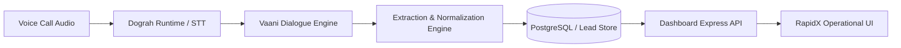

# Vaani — Operational Dashboard Data Contract

**Project:** RapidX  
**Agent:** Vaani (वाणी) — AI Used Excavator Sales & Calling Agent  
**Version:** 1.0.0 (Phase 4 Specification)  
**Status:** Canonical Data Contract (Backend to Dashboard)

---

## 1. Scope & Architectural Boundary

This document defines the strict, binding data contract between the **Vaani Voice Processing Pipeline** (Dograh voice runtime, LLM dialogue engine, structured extraction parser) and the **RapidX Operational Dashboard** (Express backend, PostgreSQL data store, frontend UI).

> [!IMPORTANT]
> - This contract specifies the **JSON payload structure**, **data types**, **validation rules**, and **lifecycle events** emitted by Vaani and consumed by the dashboard.
> - **Zero Hallucination Rule**: Any dimension not explicitly stated by the caller must be delivered as `null`. The dashboard must never render placeholder or assumed data for missing values.
> - **Compliance First**: DNC (Do-Not-Call) flags take absolute precedence over all sales funnels.



---

## 2. Core Payload Schema (Per-Call Ingestion Contract)

Whenever a call finishes, the Vaani extraction engine emits the following unified telemetry and lead payload to the dashboard backend.

### 2.1 Complete JSON Data Contract

```typescript
export interface VaaniDashboardLeadPayload {
  // 1. Lead & Customer Identity
  lead_id: string;                         // UUIDv4 format (e.g. "lead_9f1a2b3c-4d5e-6f7a-8b9c-0d1e2f3a4b5c")
  customer_id: string;                     // Deterministic customer identifier (phone hash or UUID)
  customer_name: string | null;            // Explicit caller or contractor name (null if not provided)
  primary_phone: string;                   // E.164 formatted telephone number (+91XXXXXXXXXX)
  whatsapp_phone: string | null;           // Confirmed WhatsApp number (defaults to primary_phone if confirmed)
  customer_type: 'seller' | 'buyer' | 'other' | 'unknown'; // Business classification
  ownership_type: 'direct_owner' | 'broker_munim' | 'authorized_representative' | 'unknown';

  // 2. Equipment Specifications & Operational History
  machine_details: {
    brand: string | null;                  // Canonical manufacturer (e.g. 'Tata Hitachi', 'JCB', 'Hyundai')
    model: string | null;                  // Canonical model (e.g. 'EX 200 LC', 'JS 205', 'Robex R210')
    model_year: number | null;             // Manufacturing or RTO year (2005 - 2026)
    running_hours: number | null;          // Total operating hours on hour meter (0 - 50,000)
    tonnage_class: '20_ton_class' | '21_ton_class' | '30_plus_ton_class' | 'mini_sub_10t' | 'any' | 'unknown';
    application_history: 'soil_earthwork' | 'quarry_rock' | 'rock_breaker' | 'mixed' | 'unknown';
    machine_condition_summary: string | null; // Verbal condition notes (engine blow-by, pump status, track wear)
    location_city: string | null;          // City where machine is parked or required (e.g. 'Jaipur', 'Satara')
    location_state: string | null;         // Indian state (e.g. 'Rajasthan', 'Maharashtra', 'Madhya Pradesh')
    document_status: 'all_clear_noc_ready' | 'loan_hypothecation_active' | 'tax_due' | 'rc_lost_duplicate' | 'unknown';
  };

  // 3. Commercials & Urgency
  commercial_terms: {
    expected_price_inr: number | null;     // Normalized asking price in INR (for sellers, e.g. 2400000)
    budget_max_inr: number | null;         // Normalized maximum budget in INR (for buyers, e.g. 2500000)
    price_or_budget_raw: string | null;    // Spoken string (e.g. "25 Lakh", "33 se 35 Lakh", "20-22 Lakh")
    purchase_timeline: 'immediate_within_7_days' | 'within_15_30_days' | 'future_1_3_months' | 'exploring_market' | 'not_applicable';
    yard_visit_agreed: boolean;            // Whether buyer agreed to physical Jaipur yard inspection
    yard_visit_schedule: string | null;    // Date/time agreed for yard visit (ISO 8601 or verbal slot)
  };

  // 4. Digital Evidence & WhatsApp Readiness
  evidence_readiness: {
    photos_agreed: boolean;                // Whether seller agreed to send 4-angle machine photos
    running_video_agreed: boolean;         // Whether seller agreed to send 30s operational running video
    rc_copy_agreed: boolean;               // Whether seller agreed to share RC / NOC copy
    evidence_status: 'none' | 'promised' | 'partially_received' | 'complete_verified';
  };

  // 5. Lifecycle & Routing Outcomes
  lifecycle_stage: 'NEW' | 'CONTACTED' | 'CONNECTED' | 'INTERESTED' | 'QUALIFIED' | 'PRICE_DISCUSSION' | 'FOLLOW_UP' | 'NEGOTIATION' | 'CLOSED_WON' | 'CLOSED_LOST' | 'DO_NOT_CALL';
  conversation_outcome: 'lead_qualified' | 'price_discussion' | 'callback_requested' | 'appointment_requested' | 'inquiry' | 'opt_out';
  lead_temperature: 'HOT' | 'WARM' | 'COLD';
  qualification_state: 'QUALIFIED' | 'PARTIALLY_QUALIFIED' | 'UNQUALIFIED' | 'DISQUALIFIED';

  // 6. Operations & Next Actions
  next_action: string;                     // Concrete operational instruction for sales/sourcing desk
  follow_up_required: boolean;             // Whether proactive contact is scheduled
  follow_up_datetime: string | null;       // Promised callback timestamp (ISO 8601 UTC)
  assigned_yard_location: string;          // Assigned logistics hub (default: "Jaipur (Loha Mandi / VKI Area)")
  call_notes: string;                      // Synthesized summary of unique customer quirks, terms, or context

  // 7. Compliance & Do-Not-Call (DNC)
  dnc_requested: boolean;                  // True if caller requested no further calls
  dnc_reason: string | null;               // Reason for DNC (e.g. "Caller opted out during greeting")
  dnc_timestamp: string | null;            // ISO 8601 UTC timestamp of DNC registration

  // 8. Call Metadata & Audit Telemetry
  call_metadata: {
    run_id: number;                        // Dograh workflow run identifier
    call_direction: 'INBOUND' | 'OUTBOUND';
    call_start_time: string;               // ISO 8601 UTC
    call_end_time: string;                 // ISO 8601 UTC
    duration_seconds: number;              // Active talk time
    hangup_cause: 'CALLER_HUNGUP' | 'AGENT_ENDED' | 'TIMEOUT' | 'ERROR';
    audio_recording_url: string | null;    // Local MinIO or public storage URL
  };

  // 9. Full Spoken Dialogue Transcript
  transcript: Array<{
    turn: number;
    speaker: 'agent' | 'caller';
    text: string;                          // Verbatim spoken text in Hindi / Hinglish
    timestamp_offset_ms: number;           // Milliseconds from call start
  }>;
}
```

---

## 3. Field-by-Field Detailed Contract Matrix

| Field | Type | Mandatory? | Nullable? | Validation Rules | Dashboard UI Display Component |
|---|---|---|---|---|---|
| `lead_id` | UUIDv4 | Yes | No | Must match standard UUID pattern | Lead ID header, URL routing |
| `customer_name` | string | Yes | Yes | Max 120 chars, trimmed | Contact card header, table column |
| `primary_phone` | string | Yes | No | E.164 format (+91...) | Click-to-call link, duplicate detection key |
| `whatsapp_phone` | string | Yes | Yes | E.164 format (+91...) | WhatsApp direct link (`https://wa.me/...`) |
| `customer_type` | enum | Yes | No | `seller`, `buyer`, `other`, `unknown` | Top-level badge (Green: Buyer, Blue: Seller) |
| `ownership_type` | enum | Yes | No | `direct_owner`, `broker_munim`, `authorized_representative`, `unknown` | Authority pill (`Owner` vs `Munim/Broker`) |
| `machine_details.brand` | string | Yes | Yes | Normalized to Machine Master brands | Spec card manufacturer |
| `machine_details.model` | string | Yes | Yes | Normalized model code (e.g. `EX 200 LC`) | Primary equipment title |
| `machine_details.model_year` | integer | Yes | Yes | 2005 <= year <= 2026 | Year badge |
| `machine_details.running_hours`| integer | Yes | Yes | 0 <= hours <= 50000 | Hours counter |
| `machine_details.application_history` | enum | Yes | No | `soil_earthwork`, `quarry_rock`, `rock_breaker`, `mixed`, `unknown` | Condition tag (Green: Mitti, Red: Breaker) |
| `machine_details.location_city`| string | Yes | Yes | Title case city | Geographic map pin & table column |
| `commercial_terms.expected_price_inr` | integer | Yes | Yes | Positive integer in INR | Valuation card, margin calculator |
| `commercial_terms.budget_max_inr` | integer | Yes | Yes | Positive integer in INR | Buyer demand matching filter |
| `commercial_terms.price_or_budget_raw` | string | Yes | Yes | Raw string (e.g. "25 Lakh") | Original quote tooltip |
| `commercial_terms.yard_visit_agreed` | boolean | Yes | No | Strict boolean | Inspection badge (Yes / No) |
| `commercial_terms.yard_visit_schedule` | string | Yes | Yes | ISO or verbal date | Inspection schedule calendar widget |
| `evidence_readiness.photos_agreed` | boolean | Yes | No | Strict boolean | Photo checklist checkbox |
| `evidence_readiness.running_video_agreed` | boolean | Yes | No | Strict boolean | Video checklist checkbox |
| `evidence_readiness.rc_copy_agreed` | boolean | Yes | No | Strict boolean | RC checklist checkbox |
| `lead_temperature` | enum | Yes | No | `HOT`, `WARM`, `COLD` | Red / Yellow / Blue temperature badge |
| `lifecycle_stage` | enum | Yes | No | 11 canonical stages | Funnel progression bar |
| `qualification_state` | enum | Yes | No | `QUALIFIED`, `PARTIALLY_QUALIFIED`, `UNQUALIFIED`, `DISQUALIFIED` | Qualification pill |
| `conversation_outcome` | enum | Yes | No | 6 canonical outcomes | Outcome tag |
| `next_action` | string | Yes | No | Max 255 chars | Action item checklist banner |
| `follow_up_datetime` | string | Yes | Yes | ISO 8601 UTC | Follow-up alert timer |
| `dnc_requested` | boolean | Yes | No | Strict boolean | High-visibility Red DNC quarantine banner |
| `transcript` | array | Yes | No | Chronological turn array | Dual-speaker audio playback & transcript viewer |

---

## 4. Derived Rules & Dashboard State Contract

### 4.1 Strict Zero-Hallucination Qualification Contract
The dashboard must treat the lead qualification status strictly based on backend data:
1. `QUALIFIED`: Both `machine_details.model` (or `brand` + `model_year`), `commercial_terms.expected_price_inr` (or `budget_max_inr`), and `location_city` are non-null.
2. `PARTIALLY_QUALIFIED`: At least one required qualification dimension is null. The dashboard displays a missing-dimension checklist (e.g., `Missing: Expected Price`).
3. `UNQUALIFIED` / `DISQUALIFIED`: Out of scope (e.g. non-excavator equipment, completely unresponsive caller).

### 4.2 Lead Temperature Visual Contract
- **HOT**: Displayed in urgent red styling with sound or badge notification on dashboard. Priority for 15-minute sales response.
- **WARM**: Displayed in amber styling. Slated for 24-hour follow-up.
- **COLD**: Displayed in slate/gray styling. Routed to automated WhatsApp drip.

### 4.3 DNC Quarantine Contract
- If `dnc_requested === true` or `lifecycle_stage === 'DO_NOT_CALL'`:
  - The record is **instantly removed** from all active dialing and campaign queues.
  - The record is displayed exclusively in the **DNC Quarantine Table** with red borders.
  - All outbound call, SMS, and WhatsApp action buttons are **hard-disabled** in the dashboard UI.

---

## 5. Event Ingestion Webhook Specification

The dashboard Express server will expose the following endpoint for receiving the contract payload:

- **Endpoint:** `POST /api/v1/vaani/calls/complete`
- **Headers:**
  - `Content-Type: application/json`
  - `X-RapidX-Signature: sha256=<hmac_signature>`
- **Expected Responses:**
  - `201 Created`: Payload successfully ingested, lead created/updated in PostgreSQL.
  - `400 Bad Request`: Payload violates `EXTRACTION-SCHEMA.json` or mandatory fields.
  - `401 Unauthorized`: Invalid webhook signature.

---

## 6. Summary of Architectural Guarantees
1. **Contract Stability**: Changes to this schema require updating both `docs/entity-model/EXTRACTION-SCHEMA.json` and this document.
2. **Deterministic UI State**: The dashboard requires no guesswork; all business badges, tags, and actions are 100% determined by explicit fields in this contract.
3. **Auditability**: Every extracted fact links back to turn numbers in the `transcript` array for immediate human operator verification.
