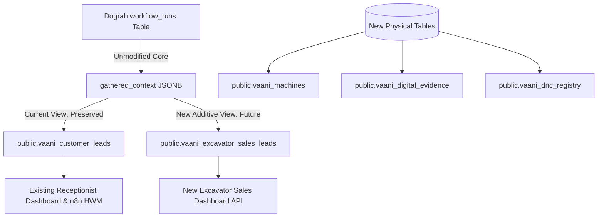

# Vaani — Additive Database Migration Plan & DDL Specification

**Project:** RapidX  
**Agent:** Vaani (वाणी) — AI Used Excavator Sales & Calling Agent  
**Target Engine:** PostgreSQL 17 (pgvector container `dograh-local-postgres-1`)  
**Status:** **PLAN ONLY — DO NOT EXECUTE IN PHASE 3** (Preserves existing receptionist database and n8n pipelines intact)

---

## 1. Schema Safety & Preservation Strategy

### 1.1 Non-Destructive Principles
1. **Existing Tables Untouched:** Tables such as `workflow_runs`, `workflows`, and `execution_entity` remain completely unmodified.
2. **Existing View Preserved:** `public.vaani_customer_leads` (queried by n8n workflow `VaaniLeadAutomationPhase5D` and `dashboard/server.js`) will continue to operate without breaking changes.
3. **No Execution in Phase 3:** This document specifies the additive migration plan. Execution will occur only in later implementation phases upon explicit authorization.



---

## 2. Additive DDL Specification (Future Migration)

### 2.1 Extended Specialized View: `public.vaani_excavator_sales_leads`

This view extracts both base contact fields and rich excavator sales variables directly from `workflow_runs.gathered_context` without requiring schema locks or table alterations:

```sql
-- Safe, additive view for Vaani Used Excavator Sales
CREATE OR REPLACE VIEW public.vaani_excavator_sales_leads AS
SELECT 
    r.id AS run_id,
    r.workflow_id,
    r.mode,
    r.call_type,
    r.created_at,
    
    -- Common Contact & Lead Identity
    (r.gathered_context -> 'extracted_variables'::text) ->> 'caller_name'::text AS caller_name,
    (r.gathered_context -> 'extracted_variables'::text) ->> 'callback_number'::text AS callback_number,
    (r.gathered_context -> 'extracted_variables'::text) ->> 'whatsapp_number'::text AS whatsapp_number,
    COALESCE((r.gathered_context -> 'extracted_variables'::text) ->> 'customer_type'::text, 'unknown') AS customer_type,
    
    -- Seller Sourcing Specific Fields
    (r.gathered_context -> 'extracted_variables'::text) ->> 'ownership_type'::text AS ownership_type,
    (r.gathered_context -> 'extracted_variables'::text) -> 'machine_details' ->> 'brand' AS machine_brand,
    (r.gathered_context -> 'extracted_variables'::text) -> 'machine_details' ->> 'model' AS machine_model,
    ((r.gathered_context -> 'extracted_variables'::text) -> 'machine_details' ->> 'model_year')::integer AS model_year,
    ((r.gathered_context -> 'extracted_variables'::text) -> 'machine_details' ->> 'running_hours')::integer AS running_hours,
    (r.gathered_context -> 'extracted_variables'::text) -> 'machine_details' ->> 'application_history' AS application_history,
    (r.gathered_context -> 'extracted_variables'::text) -> 'machine_details' ->> 'location_city' AS machine_location_city,
    (r.gathered_context -> 'extracted_variables'::text) -> 'machine_details' ->> 'location_state' AS machine_location_state,
    (r.gathered_context -> 'extracted_variables'::text) -> 'machine_details' ->> 'document_status' AS document_status,
    ((r.gathered_context -> 'extracted_variables'::text) -> 'commercial_terms' ->> 'expected_price_inr')::bigint AS expected_selling_price_inr,
    (r.gathered_context -> 'extracted_variables'::text) -> 'commercial_terms' ->> 'price_or_budget_raw' AS price_raw,
    
    -- Buyer Sales Specific Fields
    (r.gathered_context -> 'extracted_variables'::text) -> 'machine_details' ->> 'tonnage_class' AS required_tonnage_class,
    ((r.gathered_context -> 'extracted_variables'::text) -> 'commercial_terms' ->> 'budget_max_inr')::bigint AS buyer_budget_max_inr,
    (r.gathered_context -> 'extracted_variables'::text) -> 'commercial_terms' ->> 'purchase_timeline' AS purchase_timeline,
    COALESCE(((r.gathered_context -> 'extracted_variables'::text) -> 'commercial_terms' ->> 'yard_visit_agreed')::boolean, false) AS yard_visit_agreed,
    (r.gathered_context -> 'extracted_variables'::text) -> 'commercial_terms' ->> 'yard_visit_schedule' AS yard_visit_schedule,
    
    -- Evidence & Asset Status
    COALESCE(((r.gathered_context -> 'extracted_variables'::text) -> 'evidence_readiness' ->> 'photos_agreed')::boolean, false) AS photos_agreed,
    COALESCE(((r.gathered_context -> 'extracted_variables'::text) -> 'evidence_readiness' ->> 'running_video_agreed')::boolean, false) AS running_video_agreed,
    COALESCE(((r.gathered_context -> 'extracted_variables'::text) -> 'evidence_readiness' ->> 'rc_copy_agreed')::boolean, false) AS rc_copy_agreed,
    
    -- Qualification, Priority & Lifecycle
    COALESCE((r.gathered_context -> 'extracted_variables'::text) ->> 'lead_temperature'::text, 'COLD') AS lead_temperature,
    COALESCE((r.gathered_context -> 'extracted_variables'::text) ->> 'qualification_state'::text, 'UNQUALIFIED') AS qualification_state,
    COALESCE((r.gathered_context -> 'extracted_variables'::text) ->> 'conversation_outcome'::text, 'inquiry') AS conversation_outcome,
    (r.gathered_context -> 'extracted_variables'::text) ->> 'next_action'::text AS next_action,
    COALESCE(((r.gathered_context -> 'extracted_variables'::text) ->> 'follow_up_required'::text)::boolean, false) AS follow_up_required,
    (r.gathered_context -> 'extracted_variables'::text) ->> 'follow_up_datetime'::text AS follow_up_datetime,
    (r.gathered_context -> 'extracted_variables'::text) ->> 'call_notes'::text AS call_notes,
    COALESCE(((r.gathered_context -> 'extracted_variables'::text) ->> 'dnc_requested'::text)::boolean, false) AS dnc_requested,
    
    -- Raw Payload
    r.gathered_context -> 'extracted_variables'::text AS raw_extracted_variables
FROM workflow_runs r
WHERE r.workflow_id = 3;
```

---

### 2.2 Additive Physical Tables (For Inventory & Verification Tracking)

```sql
-- 1. Tracked Physical Machines (Sourced, Refurbished, Certified in Yard)
CREATE TABLE IF NOT EXISTS public.vaani_machines (
    machine_id VARCHAR(64) PRIMARY KEY,
    source_lead_run_id INTEGER REFERENCES public.workflow_runs(id) ON DELETE SET NULL,
    brand VARCHAR(64) NOT NULL,
    model VARCHAR(64) NOT NULL,
    manufacturing_year INTEGER CHECK (manufacturing_year >= 2005 AND manufacturing_year <= 2026),
    hour_meter_reading INTEGER,
    application_history VARCHAR(32) CHECK (application_history IN ('soil_earthwork', 'quarry_rock', 'rock_breaker', 'mixed', 'unknown')),
    sourcing_cost_inr BIGINT,
    target_resale_inr BIGINT,
    status VARCHAR(32) NOT NULL DEFAULT 'in_sourcing_pipeline'
        CHECK (status IN ('in_sourcing_pipeline', 'evidence_pending', 'yard_inspection_scheduled', 'refurbishment_in_progress', 'certified_ready_in_yard', 'reserved', 'sold', 'rejected')),
    current_location VARCHAR(128) DEFAULT 'Jaipur Yard (Loha Mandi / VKI Area)',
    created_at TIMESTAMP WITH TIME ZONE DEFAULT CURRENT_TIMESTAMP,
    updated_at TIMESTAMP WITH TIME ZONE DEFAULT CURRENT_TIMESTAMP
);

-- 2. WhatsApp Digital Evidence & Media Attachments
CREATE TABLE IF NOT EXISTS public.vaani_digital_evidence (
    evidence_id VARCHAR(64) PRIMARY KEY,
    machine_id VARCHAR(64) REFERENCES public.vaani_machines(machine_id) ON DELETE CASCADE,
    run_id INTEGER REFERENCES public.workflow_runs(id) ON DELETE CASCADE,
    media_type VARCHAR(32) CHECK (media_type IN ('photo_exterior', 'photo_boom', 'photo_undercarriage', 'photo_cabin', 'photo_meter', 'video_running_30s', 'doc_rc', 'doc_noc')),
    media_url TEXT NOT NULL,
    storage_path TEXT,
    received_at TIMESTAMP WITH TIME ZONE DEFAULT CURRENT_TIMESTAMP,
    evaluator_verdict VARCHAR(32) DEFAULT 'pending' CHECK (evaluator_verdict IN ('pending', 'approved', 'rejected', 'reupload_requested')),
    evaluator_notes TEXT
);

-- 3. Strict Do-Not-Call (DNC) Quarantine Registry
CREATE TABLE IF NOT EXISTS public.vaani_dnc_registry (
    phone_number VARCHAR(32) PRIMARY KEY,
    run_id INTEGER REFERENCES public.workflow_runs(id) ON DELETE SET NULL,
    reason TEXT NOT NULL,
    opted_out_at TIMESTAMP WITH TIME ZONE DEFAULT CURRENT_TIMESTAMP,
    is_active BOOLEAN DEFAULT TRUE
);
```

---

## 3. Backward Compatibility & n8n / Dashboard Safety

1. **Zero Impact on n8n Workflow `VaaniLeadAutomationPhase5D`:**
   - The n8n SQL node queries `public.vaani_customer_leads WHERE run_id > $1`.
   - Because `vaani_customer_leads` remains completely unmodified, n8n will continue to poll and process without a single error or dropped execution.
2. **Zero Impact on Dashboard Receptionist View:**
   - `dashboard/server.js` queries `vaani_customer_leads` for `/api/vaani/leads` and renders `vaani.html`.
   - Both the API and UI will remain 100% operational.
3. **Rollback Plan:**
   - If the new view or tables ever need removal, simply run:
     ```sql
     DROP VIEW IF EXISTS public.vaani_excavator_sales_leads CASCADE;
     DROP TABLE IF EXISTS public.vaani_digital_evidence CASCADE;
     DROP TABLE IF EXISTS public.vaani_machines CASCADE;
     DROP TABLE IF EXISTS public.vaani_dnc_registry CASCADE;
     ```
   - Core Dograh tables and existing views will remain 100% intact.
