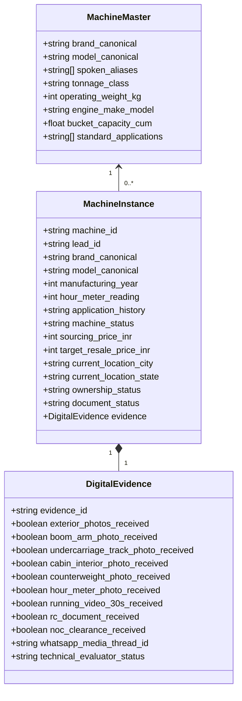

# Vaani — Machine Master Entity & Digital Evidence Model

**Project:** RapidX  
**Agent:** Vaani (वाणी) — AI Used Excavator Sales & Calling Agent  
**Context:** Grounded strictly in 18 real WhatsApp sales recordings and physical yard operations (Jaipur Loha Mandi / VKI Area).

---

## 1. Core Machine Entity Architecture

The Machine Entity models both:
1. **Catalog Definitions (Machine Master):** The reference database of verified excavator makes, models, tonnage classes, and spoken aliases.
2. **Tracked Physical Units (Machine Instances):** Specific machines moving through the sourcing, inspection, refurbishment, and resale lifecycle.

> **CRITICAL RULE:** RapidX does **not** generate fake inventory or imaginary stock. Machine instances are created strictly when an actual machine lead is sourced, verified via WhatsApp digital evidence, or physically checked in the Jaipur yard.



---

## 2. Canonical Machine Master Catalog (Derived from Real Calls)

Derived from real speech evidence across all 18 call recordings:

| Canonical Brand | Canonical Model | Spoken Aliases / Trade Names | Tonnage Class | Operating Weight (approx) | Primary Application | Call Grounding |
|---|---|---|---|---|---|---|
| **Tata Hitachi** | `EX 200 LC` | Tata 200, EX 200, 200 Model, Bada Tata | 20-Ton | 20,100 kg | Bulk excavation, earthwork, road construction | Calls #7, #13, #18 |
| **Tata Hitachi** | `EX 210 LC` | Tata 210, 210 Super, EX 210 | 21-Ton | 20,900 kg | High efficiency soil and canal excavation | Calls #13, #18 |
| **Tata Hitachi** | `EX 215 LC` | Tata 215, 215 LC | 21.5-Ton | 21,500 kg | Heavy earthwork and trenching | Calls #18 |
| **Tata Hitachi** | `EX 225 LC` | Tata 225, 225 LC | 22.5-Ton | 22,500 kg | Quarry stripping and heavy foundation | Calls #18 |
| **Tata Hitachi** | `ZAXIS 370 LCH`| Tata 370, Zaxis 370, 370 Poclain | 37-Ton | 36,800 kg | Heavy stone/granite mining, limestone quarries | Phase 1 & 2 market data |
| **JCB** | `JS 205` | JCB 205, JS 205, JCB Excavator | 20.5-Ton | 20,500 kg | Civil earthwork, pond digging, infrastructure | Calls #13, #18 |
| **JCB** | `JS 215 / JS 220` | JCB 215, JCB 220, JS 220 LC | 22-Ton | 21,900 kg | Heavy road cutting, stone handling | Calls #18 |
| **Hyundai** | `Robex R210-7` | Hyundai 210, Robex 210, Smart 210 | 21-Ton | 21,200 kg | Smooth grading, pipeline digging, canal work | Calls #13, #18 |
| **Hyundai** | `Robex R215` | Hyundai 215, R215 | 21.5-Ton | 21,500 kg | Medium stone quarry and earth moving | Calls #18 |
| **Komatsu** | `PC 210-10M0` | Komatsu 210, PC 210 | 21-Ton | 21,000 kg | Tough rock breaking, industrial infrastructure | Calls #18 |
| **Kobelco** | `SK 210 SuperX`| Kobelco 210, SK 210 | 21-Ton | 21,400 kg | Low-fuel earthwork and fast cycle digging | Phase 2 reference |
| **Sany** | `SY 215C` | Sany 215, Sany 200 | 21.5-Ton | 21,800 kg | Competitive pricing earthmoving | Phase 2 reference |
| **Generic** | `Generic Hydraulic Excavator` | Poclain, Poclen, Poklen, Poklein | All classes | 360° hydraulic swing machines | Calls #11, #18 |

---

## 3. Machine Physical Lifecycle Status

Every machine instance transitions through well-defined operational gates:

```
in_sourcing_pipeline (Owner contacted, initial specs captured)
  ↓
evidence_pending (Awaiting WhatsApp photos, meter reading & running video)
  ↓
technical_evaluation (Photos/video reviewed by Jaipur yard engineering team)
  ↓
yard_inspection_scheduled (Engineer dispatched or machine arriving at Jaipur Loha Mandi)
  ↓
refurbishment_in_progress (Hydraulic testing, seal replacement, track chain tuning, paint touchup)
  ↓
certified_ready_in_yard (Certified 50-point inspected unit available for buyer inspection)
  ↓
reserved (Buyer placed token deposit)
  ↓
sold (Full payment cleared, RTO NOC and transport transit invoice issued)
  [or: rejected — structural boom cracks, damaged pump casing, illegal registration]
```

---

## 4. Digital Evidence & Verification Model (The WhatsApp Checklist)

Derived from real human sales recordings where over 60% of substantive calls concluded with an explicit digital evidence request:

```json
{
  "evidence_id": "EV-2026-09-00124",
  "machine_id": "MCH-TATA200-2019-SATARA",
  "whatsapp_thread_id": "WA-919876543210",
  "collection_checklist": {
    "exterior_overview_4_angles": {
      "required": true,
      "received": true,
      "inspection_focus": "Structural boom integrity, counterweight dents, cabin glass"
    },
    "boom_and_arm_detailed_photo": {
      "required": true,
      "received": true,
      "inspection_focus": "Weld integrity, hydraulic cylinder chrome condition, pin bushing play"
    },
    "undercarriage_and_track_chain": {
      "required": true,
      "received": true,
      "inspection_focus": "Track shoe wear, bottom rollers, idler alignment, chain pitch extension"
    },
    "cabin_interior_and_console": {
      "required": true,
      "received": true,
      "inspection_focus": "Control levers, display monitor health, electrical wiring condition"
    },
    "hour_meter_photo": {
      "required": true,
      "received": true,
      "inspection_focus": "Odometer authenticity, tamper signs, running hours verification"
    },
    "running_video_30s": {
      "required": true,
      "received": true,
      "inspection_focus": "Engine idle sound, exhaust smoke color, hydraulic cycle speed, swing motor smoothness"
    },
    "rc_and_noc_document": {
      "required": true,
      "received": false,
      "inspection_focus": "Hypothecation clearance, road tax validity, original ownership verification"
    }
  },
  "technical_verdict": "RECOMMENDED_FOR_YARD_INSPECTION",
  "evaluator_notes": "Clean soil earthwork history confirmed. Hydraulic cylinders have no oil seepage. Undercarriage at ~65% life."
}
```

---

## 5. Real-Call Grounded Valuation Benchmarks

Based strictly on real call negotiations (Calls #7, #13, #14):

| Manufacturing Year | Working Application | Fair Sourcing Price (Buy Side) | Fair Resale Price (Sell Side) | Gross Margin Target | Real Call Evidence |
|---|---|---|---|---|---|
| **2024 (Under 1,500 hrs)** | Soil Earthwork (*Mitti*) | ₹30.0L – ₹32.0L | ₹34.0L – ₹36.5L | ₹3.5L – ₹4.5L | Call #7 & #13 (Singrauli / Jaipur) |
| **2022–2023 (3,000–5,000 hrs)** | Soil Earthwork (*Mitti*) | ₹25.0L – ₹27.5L | ₹29.0L – ₹32.0L | ₹3.5L – ₹4.5L | Inventory standard |
| **2019 (6,000–9,000 hrs)** | Soil Earthwork (*Mitti*) | ₹19.0L – ₹22.0L | ₹24.0L – ₹26.5L | ₹3.0L – ₹4.0L | Call #14 (Seller asked ₹25L; agent counter: ₹25L is excessive for 2019) |
| **2019 (Rock / Breaker)** | Stone Quarry (*Pahad/Breaker*) | ₹15.0L – ₹17.5L | ₹19.5L – ₹22.0L | ₹3.5L – ₹4.5L | Call #13 (Heavy discount applied due to high pump wear) |
| **2015–2017 (Older Units)** | Mixed / Earthwork | ₹12.0L – ₹15.0L | ₹16.0L – ₹18.5L | ₹2.5L – ₹3.5L | Budget buyer segment |

---

## 6. Safety & Integrity Guarantees
- **No Synthetic Stock:** Never present a machine as available in the Jaipur yard unless its physical presence and engine serial number are registered.
- **Auditable Pricing:** Never quote a buying or selling price without grounding it in the model year, running hours, and application history (*mitti* vs *breaker*).
