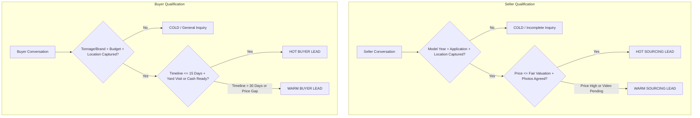

# Vaani — Seller & Buyer Entity Schemas

**Project:** RapidX  
**Agent:** Vaani (वाणी) — AI Used Excavator Sales & Calling Agent  
**Context:** Grounded in 18 real WhatsApp sales recordings and physical yard operations (Jaipur Loha Mandi / VKI Area).

---

## 1. Primary Commercial Flow 1: Seller / Machine Sourcing

When Vaani calls or receives a call from an excavator owner or broker looking to sell equipment to RapidX.

### 1.1 Complete Field Specification

| Field Name | Type | Allowed Values / Constraints | Evidence / Grounding Source | Description |
|---|---|---|---|---|
| `customer_name` | `string \| null` | UTF-8 Text | Real calls (e.g. Ramesh Patel, Banse) | Name of caller/owner. |
| `callback_number` | `string` | E.164 format (e.g. `+919876543210`) | Caller ID or explicitly confirmed phone number | Primary contact number. |
| `whatsapp_number` | `string \| null` | E.164 format | Calls #8, #15 ("Kya yehi number WhatsApp pe hai?") | Number for digital asset collection. Defaults to callback number if confirmed. |
| `ownership_type` | `enum` | `direct_owner`, `broker_munim`, `authorized_representative`, `unknown` | Call #11 (`[035.0s]` - "Munim ko phone lagaya... kisi aur ki machine hai") | Distinguishes actual owner from intermediary/broker. |
| `machine_brand` | `string \| null` | Canonical brand: `Tata Hitachi`, `JCB`, `Hyundai`, `Komatsu`, `Kobelco`, `Sany`, `Other` | Calls #7, #13, #18 | Normalized machine manufacturer. |
| `machine_model` | `string \| null` | Canonical model: `EX 200 LC`, `EX 210`, `JS 205`, `R210`, `PC 210`, etc. | Calls #7, #13, #14, #18 | Exact model series. |
| `model_year` | `integer \| null` | `2005 <= year <= 2026` | Calls #7, #13, #14 (2019, 2024 models) | Manufacturing or RTO registration year. |
| `running_hours` | `integer \| null` | `0 <= hours <= 50000` | Machine hour-meter reading | Total operating hours recorded on hour meter. |
| `machine_condition` | `string \| null` | Text summary | Calls #5, #13 | Qualitative condition summary from caller. |
| `application_history` | `enum` | `soil_earthwork`, `quarry_rock`, `rock_breaker`, `mixed`, `unknown` | Call #13 (`[064.0s - 072.0s]` - "Mitti mein chali hui vs pahadon mein") | Crucial value factor: soil work = premium; breaker = heavy discount. |
| `engine_condition` | `enum` | `original_sealed`, `overhauled_serviced`, `smoking_blowby`, `unknown` | Engineering checklist | Condition of diesel engine (Cummins / Isuzu / Kirloskar). |
| `pump_condition` | `enum` | `original_healthy`, `repaired_replaced`, `weak_slow_cycle`, `unknown` | Engineering checklist | Hydraulic main pump pressure & cycle speed. |
| `undercarriage_condition` | `enum` | `good_70_plus`, `average_50_70`, `worn_sub_50`, `unknown` | Engineering checklist | Track chain, rollers, idler, and shoe life percentage. |
| `machine_location_city` | `string \| null` | City name (e.g., Satara, Singrauli, Jaipur) | Calls #7, #10, #13, #14, #16, #17 | Physical location where machine is currently parked or working. |
| `machine_location_state` | `string \| null` | Indian State (e.g., Rajasthan, Maharashtra, MP, Assam) | Calls #7, #14, #16, #17 | State location for regional logistics costing. |
| `ownership_status` | `enum` | `first_owner`, `second_owner`, `multiple_owners`, `unknown` | Trade standard | Number of prior owners on RC book. |
| `document_status` | `enum` | `all_clear_noc_ready`, `loan_hypothecation_active`, `tax_due`, `rc_lost_duplicate`, `unknown` | Legal compliance | RTO hypothecation and NOC transferability. |
| `expected_selling_price` | `integer \| null` | Price in INR (e.g. `2500000`) | Calls #7, #13, #14 (e.g. ₹25 Lakh) | Raw asking price from seller. |
| `expected_price_raw` | `string \| null` | Spoken string (e.g. "25 Lakh", "33 se 35 Lakh") | Real call transcripts | Original unparsed spoken amount. |
| `photos_available` | `boolean` | `true \| false` | Calls #7, #8, #12, #14, #17 | Whether seller agrees to send machine photos via WhatsApp. |
| `running_video_available` | `boolean` | `true \| false` | Call #17 (`[030.0s]` - "ek running video aur photo bhejiyega") | Whether seller has a 30s operational video of machine working. |
| `seller_intent` | `enum` | `immediate_liquidation`, `price_discovery`, `exploring_exchange`, `uncommitted` | Commercial rating | Urgency level of the seller. |
| `lead_temperature` | `enum` | `HOT`, `WARM`, `COLD` | Scoring rules (Section 3) | Commercial priority for rapid inspection/closing. |
| `conversation_outcome` | `enum` | `lead_qualified`, `price_discussion`, `callback_requested`, `inquiry`, `opt_out` | Dograh/n8n standard taxonomy | Primary outcome for routing. |
| `next_action` | `string` | Actionable instruction | Calls #13, #17 | e.g. "Request 4-angle WhatsApp photos and schedule yard visit". |
| `follow_up_required` | `boolean` | `true \| false` | Operations tracking | Whether a sales officer callback is needed. |
| `follow_up_datetime` | `timestamp \| null` | ISO 8601 string | Operations scheduling | Promised time for follow-up call or inspection. |
| `call_notes` | `text` | Concise Hindi/English notes | CRM review | Summary of specific terms, operator remarks, or quirks. |

---

## 2. Primary Commercial Flow 2: Buyer / Machine Sales

When Vaani speaks with a contractor, builder, or quarry operator looking to purchase a certified used or refurbished excavator from RapidX inventory.

### 2.1 Complete Field Specification

| Field Name | Type | Allowed Values / Constraints | Evidence / Grounding Source | Description |
|---|---|---|---|---|
| `customer_name` | `string \| null` | UTF-8 Text | Real calls (e.g., Banse, Om Builders) | Customer or contractor name. |
| `callback_number` | `string` | E.164 format | Caller ID or confirmed phone number | Primary contact number. |
| `whatsapp_number` | `string \| null` | E.164 format | Calls #8, #15 | Number for sending catalog, photos, and Google Maps pin. |
| `required_brand` | `string \| null` | `Tata Hitachi`, `JCB`, `Hyundai`, `Komatsu`, `Kobelco`, `Sany`, `Any` | Calls #13, #18 | Preferred machine manufacturer. |
| `required_model` | `string \| null` | `EX 200 LC`, `JS 205`, `R210`, etc. | Calls #13, #18 | Preferred model series. |
| `tonnage_class` | `enum` | `20_ton_class`, `21_ton_class`, `30_plus_ton_class`, `mini_sub_10t`, `any` | Industrial classification | Machine operating weight category (20-ton is 80%+ of demand). |
| `intended_application` | `enum` | `soil_earthwork`, `road_construction`, `stone_quarry`, `canal_irrigation`, `rental_fleet`, `unknown` | Grounded in call dialogue | Primary application where machine will be deployed. |
| `refurbished_preference`| `enum` | `certified_refurbished`, `as_is_used`, `budget_running_condition`, `either` | RapidX business model | Whether buyer insists on tested/refurbished unit with warranty. |
| `budget_min_inr` | `integer \| null` | Value in INR | Calls #13, #18 | Minimum budget ceiling. |
| `budget_max_inr` | `integer \| null` | Value in INR | Calls #13, #18 | Maximum budget ceiling. |
| `budget_raw` | `string \| null` | Text string (e.g. "22-25 Lakh", "30 Lakh tak") | Spoken transcript | Original spoken budget phrase. |
| `purchase_location_city` | `string \| null` | City name (e.g., Kishangarh, Ajmer, Jaipur) | Calls #10, #16 | Deployment or delivery destination. |
| `purchase_location_state`| `string \| null` | State name (e.g., Rajasthan) | Calls #10, #16 | State of deployment. |
| `purchase_timeline` | `enum` | `immediate_within_7_days`, `within_15_30_days`, `future_1_3_months`, `exploring_market` | Commercial scoring | When buyer needs machine at site. |
| `buyer_intent` | `enum` | `ready_cash_or_loan_approved`, `requires_financing`, `comparing_quotes`, `casual_inquiry` | Qualification logic | Financial preparedness of the buyer. |
| `yard_visit_interested` | `boolean` | `true \| false` | Calls #10, #13 ("Jaipur mein Loha Mandi visit karna hai") | Whether buyer agreed to visit Jaipur yard for physical inspection. |
| `yard_visit_date` | `string \| null` | ISO date or text (e.g. "Kal dopahar 2 baje") | Calls #10, #13 | Scheduled yard appointment. |
| `lead_temperature` | `enum` | `HOT`, `WARM`, `COLD` | Scoring rules (Section 3) | Commercial priority for yard scheduling. |
| `conversation_outcome` | `enum` | `lead_qualified`, `appointment_requested`, `callback_requested`, `inquiry`, `opt_out` | Dograh/n8n standard taxonomy | Primary outcome for routing. |
| `next_action` | `string` | Actionable instruction | Calls #10, #15 | e.g. "Send Jaipur yard Google Maps location and PDF catalog on WhatsApp". |
| `follow_up_required` | `boolean` | `true \| false` | Operations tracking | Whether a sales officer callback is needed. |
| `follow_up_datetime` | `timestamp \| null` | ISO 8601 string | Operations scheduling | Promised time for follow-up. |
| `call_notes` | `text` | Concise Hindi/English notes | CRM review | Customer's specific job site needs, financing request, or notes. |

---

## 3. Transparent Lead Temperature & Qualification Rules

No opaque machine learning scores are permitted. Rules are 100% deterministic and auditable:

### 3.1 Seller Sourcing Scoring Logic
- **HOT SELLER LEAD:**
  1. `machine_brand` AND `model_year` AND `machine_location_city` are known.
  2. `application_history` is `soil_earthwork` (clean machine) OR price is discounted appropriately.
  3. `expected_selling_price` is within realistic market benchmark (e.g. 2019 model <= ₹24L, 2024 model <= ₹35L).
  4. `photos_available` is `true` OR seller agreed to share WhatsApp running video.
  5. `seller_intent` is `immediate_liquidation`.
- **WARM SELLER LEAD:**
  1. Machine brand, model year, and location known.
  2. Asking price is somewhat above market (e.g. 2019 asking ₹25L–₹27L) but seller agreed to negotiate upon physical inspection.
  3. Photos/videos promised within 24 hours.
- **COLD SELLER LEAD:**
  1. Missing model year or location.
  2. Grossly inflated price expectation (e.g. 2015 model asking ₹28L).
  3. Broker/Munim refuses to connect with direct owner or share machine photos.

### 3.2 Buyer Sales Scoring Logic
- **HOT BUYER LEAD:**
  1. `tonnage_class` (or specific brand `Tata 200` / `JCB 205`) AND `budget_max_inr` AND `purchase_location_city` known.
  2. `purchase_timeline` is `immediate_within_7_days` OR `within_15_30_days`.
  3. `yard_visit_interested` is `true` (agreed to inspect machines at Jaipur Loha Mandi) OR buyer has pre-approved cash/finance.
- **WARM BUYER LEAD:**
  1. Definite machine requirement and budget specified.
  2. Purchase timeline is 15–45 days, or buyer requested inventory catalog before committing to a yard visit.
- **COLD BUYER LEAD:**
  1. Unclear machine requirement or "just checking rates" without project timeline.
  2. Budget unrealistic for requested model (e.g. asking for 2022 Tata 200 for ₹12 Lakh).

### 3.3 Strict Qualification Gate
A lead **CANNOT** be set to `conversation_outcome = "lead_qualified"` unless all three baseline dimensions are captured:
1. **Target Specification:** (Specific Model/Brand/Year for Seller; Tonnage/Brand for Buyer).
2. **Commercial Parameter:** (Expected Selling Price for Seller; Budget Ceiling for Buyer).
3. **Geographic Parameter:** (Current Machine Location for Seller; Deployment/Delivery Location for Buyer).

If any of these 3 dimensions is null, the outcome must be classified as `inquiry`, `callback_requested`, or `price_discussion`.
