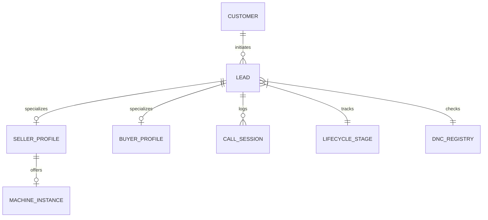
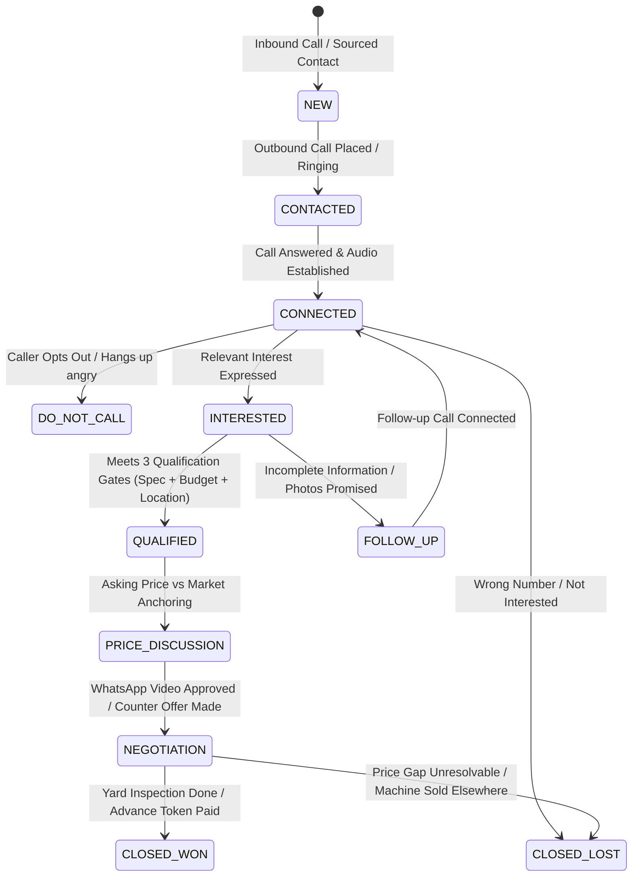
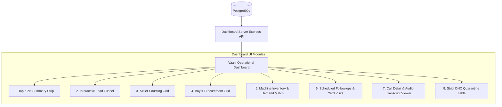

# Vaani — Unified Entity Architecture & Lifecycle Specification

**Project:** RapidX  
**Agent:** Vaani (वाणी) — AI Used Excavator Sales & Calling Agent  
**Context:** Enterprise Data Architecture Grounded in 18 Real WhatsApp Sales Calls

---

## 1. Unified Lead Entity Specification

To support both **Seller Sourcing** and **Buyer Sales** within a single, consistent relational and event-driven architecture, Vaani utilizes a **Unified Lead Entity**.



### 1.1 Core Unified Lead Schema

```typescript
interface UnifiedLead {
  // Identity & Source
  lead_id: string;                    // UUIDv4 (e.g. "lead_9f1a2b3c...")
  customer_id: string;                // Normalized customer identifier (E.164 phone hash or UUID)
  customer_name: string | null;       // Full name or business name
  primary_phone: string;              // E.164 formatted telephone number
  whatsapp_phone: string | null;      // Confirmed WhatsApp phone number
  lead_type: 'SELLER' | 'BUYER';      // Core business classification
  
  // Commercial & Lifecycle Status
  lifecycle_stage: LeadLifecycleStage; // Formal CRM sales stage
  lead_temperature: 'HOT' | 'WARM' | 'COLD'; // Objective priority tier
  commercial_intent: string;          // Intent enum (e.g. "immediate_liquidation", "ready_cash_buyer")
  qualification_state: 'UNQUALIFIED' | 'PARTIALLY_QUALIFIED' | 'QUALIFIED' | 'DISQUALIFIED';
  conversation_outcome: ConversationOutcome; // Standardized call outcome
  
  // Operations & Next Actions
  next_action: string;                // Specific immediate operational instruction
  follow_up_required: boolean;        // Whether a callback or action is scheduled
  follow_up_datetime: string | null;  // ISO 8601 UTC timestamp
  follow_up_reason: string | null;    // Operational context (e.g. "Review WhatsApp running video")
  assigned_yard_location: string;     // Default: "Jaipur (Loha Mandi / VKI Area)"
  assigned_manager: string | null;    // Regional sales/procurement officer
  
  // Compliance & Suppression
  dnc_state: boolean;                 // TRUE if caller opted out or requested removal
  dnc_reason: string | null;          // e.g. "Customer requested not to be called"
  dnc_timestamp: string | null;       // Timestamp when DNC was registered
  
  // Call Metadata & Telemetry
  source_channel: 'INBOUND_VOICE' | 'OUTBOUND_VOICE' | 'WHATSAPP_INQUIRY';
  last_call_run_id: number;           // Foreign key to Dograh workflow_runs.id
  call_count: number;                 // Total call attempts/connections
  total_duration_sec: number;         // Cumulative call seconds
  created_at: string;                 // ISO 8601 timestamp
  updated_at: string;                 // ISO 8601 timestamp
  
  // Dynamic Type-Specific Payload
  seller_details?: SellerSourcingDetails; // Present if lead_type === 'SELLER'
  buyer_details?: BuyerSalesDetails;       // Present if lead_type === 'BUYER'
}
```

---

## 2. Lead Lifecycle & State Transitions

The lead moves strictly along an auditable, deterministic lifecycle state machine:



### 2.1 Formal Lifecycle Stage Definitions

| Stage Name | Entry Criteria | Exit Gate to Next Stage | Fallback / Rejection |
|---|---|---|---|
| `NEW` | Record created from phone number, campaign list, or inbound trigger. | First dialing attempt initiated. | Duplicate merge |
| `CONTACTED` | Call initiated and ringing; telephony signaling established. | Call answered and speech detected. | `UNREACHABLE` after 3 attempts |
| `CONNECTED` | Two-way audio active; greeting delivered by Vaani. | Caller confirms they own or seek excavator. | `DO_NOT_CALL` if opted out; `CLOSED_LOST` if no interest |
| `INTERESTED` | Caller confirms intent to buy or sell equipment. | Capturing machine specs, pricing, and location. | `FOLLOW_UP` if caller is busy/driving |
| `QUALIFIED` | **Strict Gate:** All 3 dimensions captured (Machine Model/Year + Expected Price/Budget + City/State). | Initiating pricing discussion or yard visit. | Stays in `INTERESTED` if partial |
| `PRICE_DISCUSSION` | Comparing seller asking price to market valuation (or buyer budget to inventory). | Reaching agreed valuation window; requesting WhatsApp assets. | `FOLLOW_UP` for asset review |
| `FOLLOW_UP` | Scheduled callback or pending digital asset arrival (photos, running video, RC). | Assets received and reviewed by engineering team. | Stale after 7 days |
| `NEGOTIATION` | Final price or token advance under discussion after physical yard visit / video review. | Commercial agreement reached. | `CLOSED_LOST` if deal breaks |
| `CLOSED_WON` | Seller contract signed & machine dispatched / Buyer token paid. | Machine inventory updated in ERP. | Terminal state |
| `CLOSED_LOST` | Price gap too wide, machine failed technical inspection, or bought elsewhere. | Documented loss reason. | Terminal state |
| `DO_NOT_CALL` | **Immediate Override:** Caller asks not to be called or demands data removal. | Immediate suppression across all dialers and SMS/WhatsApp channels. | Permanent quarantine |

### 2.2 Strict DNC / Opt-Out Guardrail
Any caller requesting opt-out (`"mujhe dobara phone mat karna"`, `"remove my number"`, `"call mat karo"`) is routed **immediately** to `DO_NOT_CALL`:
- Telephony runner terminates without argument.
- `dnc_state = true` is set in the database.
- Future outbound campaigns strictly filter `WHERE dnc_state = false`.

---

## 3. Strict Qualification Rule (Zero-Hallucination Gate)

To prevent premature qualification and spamming the physical yard with unqualified leads, a lead **MUST NOT** be set to `QUALIFIED` unless:

$$\text{Qualified} = \text{Target Specification} \land \text{Commercial Parameter} \land \text{Geographic Parameter}$$

```
For Seller Leads:
  - machine_brand != null AND model_year != null
  - expected_selling_price != null
  - machine_location_city != null

For Buyer Leads:
  - required_brand != null OR tonnage_class != null
  - budget_max_inr != null
  - purchase_location_city != null
```

If any one of these 3 fields is null or unstated:
- `qualification_state` = `'PARTIALLY_QUALIFIED'`
- `conversation_outcome` = `'inquiry'` or `'callback_requested'`
- `lifecycle_stage` = `'INTERESTED'` or `'FOLLOW_UP'`

---

## 4. Dashboard Mapping & Operational UI Architecture

This entity architecture maps directly into the future RapidX / Vaani operational dashboard:



### Detailed Field-to-UI Mapping Matrix

| Dashboard Module | Source Entity & Fields | Display Element | User Interaction / Action |
|---|---|---|---|
| **Top KPIs Strip** | `COUNT(*)`, `lead_temperature`, `revenue_potential` | Cards: Total Leads, Hot Sellers, Hot Buyers, Yard Visits Scheduled, DNC Total | Real-time counts, filtering trigger |
| **Lead Funnel** | `lifecycle_stage` (NEW → WON) | Visual funnel bar chart with conversion drop-offs | Click stage to filter grid below |
| **Seller Sourcing Grid** | `seller_details` (Brand, Model, Year, Hours, Mitti vs Breaker, Asking Price, Photos) | Dense data table with status badges (`HOT`, `WARM`, `COLD`) | "View WhatsApp Video", "Schedule Yard Inspection", "Send Price Counter" |
| **Buyer Procurement Grid** | `buyer_details` (Required Model, Tonnage, Budget, Location, Timeline, Yard Visit) | Dense data table with status badges | "Match with Yard Stock", "Send PDF Catalog", "Book Yard Visit" |
| **Machine Demand Match** | Machine Master vs Buyer requirements | Match scoring matrix (e.g. Tata 200 in Jaipur vs 4 waiting buyers) | 1-Click "Dispatch WhatsApp Offer to Matching Buyers" |
| **Follow-ups & Yard Visits** | `follow_up_datetime`, `assigned_yard_location` | Chronological task calendar & alert banner | Direct dial button, yard gate-pass confirmation |
| **Call Detail & Transcript** | `workflow_runs`, `gathered_context`, `transcripts` | Audio playback player + dual-speaker transcript with highlighted extracted facts | Audit AI extraction accuracy against real audio |
| **DNC Isolation Table** | `dnc_state = true`, `dnc_reason`, `dnc_timestamp` | Standalone quarantined red-border table | Complete exclusion from outbound dialer; compliance export |
